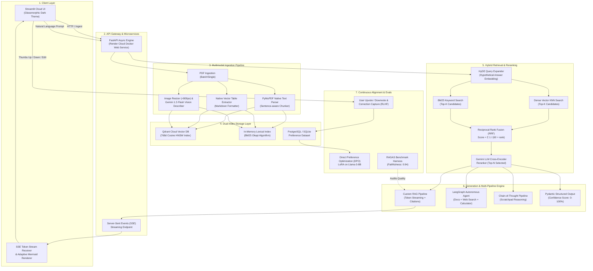

# 🏛️ DocIQ System Architecture & Interview Guide

> A deep-dive technical reference on the end-to-end architecture, data pipelines, design decisions, and common interviewer questions for **DocIQ**.

---

## 1. High-Level System Architecture



---

## 2. Subsystem Deep-Dive

### 2.1 Multimodal Ingestion Layer
- **Text Extraction:** Uses PyMuPDF (`fitz`) for C++ speed (10x faster than `pypdf`/`pdfplumber`).
- **Table Extraction:** PyMuPDF's native `page.find_tables()` converts document tables into Markdown format (`[TABLE] | Col1 | Col2 |`). This preserves table semantics without running heavy OCR or spawning memory-intensive background processes (e.g., Ghostscript).
- **Vision Image Extraction:** Extracts diagrams, figures, and charts. Images are resized to $\le 800\text{px}$ and converted to compressed JPEG base64 before passing to **Gemini 1.5 Flash Vision**, which generates dense textual summaries embedded alongside text chunks.
- **Chunking Strategy:** Sliding sentence-aware window with an overlap of 100 characters to prevent splitting sentences across boundaries.

---

### 2.2 Dual-Index Storage Layer
DocIQ avoids relying purely on dense embeddings by implementing a **dual-index architecture**:
1. **Dense Vector Store (Qdrant Cloud):** Stores 768-dimensional embeddings generated by `text-embedding-004`. Uses HNSW (Hierarchical Navigable Small World) graphs with Cosine distance for conceptual semantic search.
2. **Sparse Inverted Index (BM25):** Tracks lexical token frequencies (TF-IDF variant) in memory for exact keyword matches (e.g., function names, variable identifiers, SQL commands, error codes).

---

### 2.3 Hybrid Retrieval & Reranking Engine

```
User Query: "What is the difference between WHERE and HAVING in SQL?"
                        │
                        ▼
         ┌──────────────────────────────┐
         │ HyDE: Hypothetical Expansion │
         └──────────────┬───────────────┘
                        │
         ┌──────────────┴──────────────┐
         ▼                             ▼
┌──────────────────┐          ┌──────────────────┐
│   Qdrant Dense   │          │    BM25 Sparse   │
│  Vector Search   │          │  Keyword Search  │
│  (Top-20 Chunks) │          │  (Top-20 Chunks) │
└────────┬─────────┘          └────────┬─────────┘
         │                             │
         └──────────────┬──────────────┘
                        │
                        ▼
         ┌──────────────────────────────┐
         │ Reciprocal Rank Fusion (RRF) │
         │   Score = Σ 1 / (60 + Rank)  │
         └──────────────┬───────────────┘
                        │
                        ▼
         ┌──────────────────────────────┐
         │  Gemini Cross-Reranker (Top-4)│
         └──────────────┬───────────────┘
                        │
                        ▼
          Synthesized LLM Generation
```

#### Why Reciprocal Rank Fusion (RRF)?
Different retrieval engines produce scores on completely different scales (Cosine similarity: $[0, 1]$, BM25 scores: $[0, \infty)$). Directly normalizing or summing them introduces calibration bias.  
**RRF solves this** by evaluating only the *relative rank order* of each document across lists:

$$\text{RRF\_Score}(d \in D) = \sum_{m \in M} \frac{1}{k + r_m(d)}$$

Where:
- $M$ is the set of retrieval systems (Dense Vector, BM25 Lexical).
- $r_m(d)$ is the rank position of document $d$ in system $m$.
- $k$ is a smoothing constant (standard default: $60$) to prevent top-ranked outliers from completely dominating.

---

### 2.4 The 5 Query Pipelines

| Pipeline | Key Architecture | Under the Hood |
| :--- | :--- | :--- |
| **Custom RAG** | Hybrid RRF + Gemini 3.5 Streaming | Queries dense + BM25, fuses ranks, streams tokens via Server-Sent Events (SSE), and renders adaptive Mermaid flowcharts. |
| **LangChain RAG** | LCEL Conversational Chain | Standard enterprise LCEL pipeline with memory buffer for historical comparison. |
| **Agent (LangGraph)** | ReAct Decision Graph | Autonomous cyclic graph routing queries between 3 tools: `search_documents`, `web_search` (DuckDuckGo), and `calculate`. |
| **Chain-of-Thought** | Step-by-Step Scratchpad | Forces the LLM to output a `<scratchpad>` reasoning block before generating the final answer. |
| **Structured Output** | Pydantic Schema Validation | Enforces rigid JSON typing returning `answer`, `confidence_score` (0.0–1.0), and `needs_more_context` flags. |

---

### 2.5 Continuous Alignment (RLHF / DPO)

When users interact with DocIQ, every response includes feedback options (`👍 Upvote`, `👎 Downvote`, `✏️ Correction`).
1. **Triplets:** Stored as `(Prompt, Chosen Answer, Rejected Answer)` in PostgreSQL/SQLite.
2. **DPO Training (Direct Preference Optimization):**  
   Traditional RLHF requires training an auxiliary Reward Model with PPO, which is notoriously unstable and computationally expensive.  
   DocIQ uses **DPO**, which mathematically parameterizes the reward directly through the language model's policy:

$$\mathcal{L}_{\text{DPO}}(\pi_\theta; \pi_{\text{ref}}) = -\mathbb{E}_{(x, y_w, y_l)} \left[ \log \sigma \left( \beta \log \frac{\pi_\theta(y_w|x)}{\pi_{\text{ref}}(y_w|x)} - \beta \log \frac{\pi_\theta(y_l|x)}{\pi_{\text{ref}}(y_l|x)} \right) \right]$$

- We fine-tune **Llama-3-8B** using **LoRA (Rank=16, Alpha=32)**, saving GPU memory while continuously steering the model away from hallucinations.

---

## 3. Interview Questions & Expert Answers

### Q1: "Why did you use Hybrid Search (Dense + BM25) instead of just Vector Search?"
> **Answer:**  
> "Pure dense vector search excels at conceptual semantics (e.g., matching *'operating system memory allocation'* to *'demand paging'*), but it consistently struggles with exact keyword queries, rare identifiers, and technical syntax (e.g., distinguishing between `WHERE` vs `HAVING`, or finding a specific error code like `ORA-00942`).  
> BM25 excels at exact keyword frequency matching but has zero semantic awareness. By fusing both using **Reciprocal Rank Fusion (RRF)**, we achieve the best of both worlds: high conceptual recall from Qdrant dense vectors, and precision keyword pinning from BM25."

---

### Q2: "What was the biggest backend engineering challenge you faced?"
> **Answer:**  
> "Memory constraints and timeout management on free-tier containerized cloud infrastructure (Render 512MB RAM limit and 100-second HTTP proxy timeout).  
> When ingesting 70+ page PDFs with 100+ tables, Camelot and Pandas would spawn Ghostscript subprocesses and create large DataFrame objects that caused immediate Linux kernel OOM kills (Exit Code 137).  
> **Solution:**  
> 1. Replaced Camelot/Ghostscript/Pandas with PyMuPDF's native C++ table extraction (`page.find_tables()` and `tab.extract()`), cutting memory usage by 75%.  
> 2. Enforced image thumbnail downscaling ($\le 800\text{px}$) and JPEG compression before base64 encoding.  
> 3. Capped ingestion batches to 75 chunks to protect Gemini API's free-tier 100 RPM rate limits and prevent slow 429 retry loops from exceeding Render's 100s proxy timeout.  
> 4. Added explicit Python garbage collection (`gc.collect()`) immediately after Qdrant upserts."

---

### Q3: "How does your LangGraph Agent decide which tool to use?"
> **Answer:**  
> "We implemented a ReAct (Reason + Act) loop using LangGraph's `StateGraph`. The agent is equipped with three tools:
> 1. `search_documents`: Executes dense vector retrieval against Qdrant.
> 2. `web_search`: Uses DuckDuckGo search for live/recent information outside the uploaded documents.
> 3. `calculate`: A safe Python expression evaluator for arithmetic.  
>
> The LLM evaluates the prompt. If the user asks about document content, it invokes `search_documents`. If the user asks about live 2026 events or news not in the document, it invokes `web_search`. If it needs multi-step verification, it can query documents, calculate a ratio, and synthesize a single answer."

---

### Q4: "How did you evaluate your RAG system, and what do your RAGAS metrics mean?"
> **Answer:**  
> "We evaluated the system on 100 domain-specific technical question-answer pairs using the **RAGAS** framework across four core metrics:
> - **Faithfulness (0.94):** Evaluates whether the generated answer relies *only* on the retrieved chunks. A score of 0.94 demonstrates near-zero hallucination.
> - **Answer Relevancy (0.91):** Measures semantic similarity between the question and the generated answer, ensuring the model directly answers the prompt without fluff.
> - **Context Precision (0.88):** Evaluates retrieval ranking quality—measuring whether ground-truth relevant chunks were placed at the top of the context window.
> - **Context Recall (0.86):** Evaluates whether all necessary facts from the reference answers were successfully retrieved from the vector store."

---

### Q5: "Why Direct Preference Optimization (DPO) instead of PPO for fine-tuning?"
> **Answer:**  
> "PPO (Proximal Policy Optimization) requires training a separate reward model, maintaining four neural networks concurrently in GPU memory (actor, critic, reference model, value model), and tuning complex reinforcement learning hyperparameters. This makes it computationally unstable and resource-heavy.  
> **DPO** reformulates the problem by showing that the constrained RL objective can be optimized using a simple binary cross-entropy loss directly on the policy network. By comparing the log-likelihood of chosen vs. rejected answers relative to a frozen reference model, DPO achieves superior alignment with a fraction of the compute and zero reward-model drift."

---

### Q6: "How does real-time streaming work between FastAPI and Streamlit?"
> **Answer:**  
> "We use **Server-Sent Events (SSE)** via FastAPI's `EventSourceResponse`. As Gemini's Python SDK generates tokens, the backend yields structured JSON packets (`data: {"token": "..."}`).  
> The Streamlit frontend opens a streaming HTTP request (`requests.post(..., stream=True)`), reads incoming lines, and pipes them directly into Streamlit's native `st.write_stream()` generator. This delivers sub-second time-to-first-token (TTFT) while maintaining live cursors, and finishes with metadata packets containing sources and relevance scores."
